# wknd-next

A headless **WKND trip-companion app** built with Next.js. Every piece of content comes from **AEM Content Fragments**, every content element is **editable in Universal Editor**, and the **CF editor's "Preview" button opens the app** on the fragment you're editing.

**Live:** https://wknd-next.vercel.app · **Repo:** `AEMXSC/wknd-next` · Built on the same pattern as [`citizens-next`](https://github.com/AEMXSC/citizens-next).

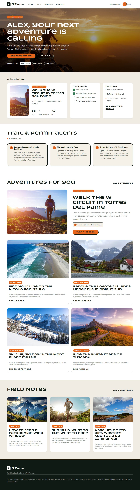

---

## Contents

1. [What to show: demo script](#what-to-show-demo-script)
2. [Features](#features)
3. [How it works](#how-it-works)
4. [Content model](#content-model)
5. [Run it locally](#run-it-locally)
6. [Set it up in your own AEM CS sandbox](#set-it-up-in-your-own-aem-cs-sandbox)
7. [Gotchas we hit](#gotchas-we-hit)
8. [Customizing](#customizing)
9. [Project structure](#project-structure)

---

## What to show: demo script

About 5 minutes. Each step is one AEM capability.

| # | Do this | The point |
|---|---|---|
| 1 | Open the app. Switch **Viewing as** Alex → Maya → Sam. | **One fragment, many audiences.** The hero is one fragment. Tokens like `{{profile.name}}` resolve from a Persona fragment, and each audience gets its own **fragment variation** with its own image and copy. |
| 2 | Open the same URL in **Universal Editor**. Click the hero title. | **Edit in context.** Authors see the raw `{{profile.*}}` tokens, so they edit the template rather than one person's copy. Every card, alert and persona is selectable. |
| 3 | Edit a **trail alert**, then publish it. Watch the app (outside UE). | **One edit, every surface.** The alert updates in three places within about 10 s: the alerts band, the Patagonia card, and My Trip's permit panel. They are the same fragment, referenced from the adventure. |
| 4 | In the **CF editor**, open an adventure and set **Card layout** to Featured. Publish. | **Authors control presentation from structured content.** That card becomes the large featured card. |
| 5 | In the CF editor, click **Preview** on any fragment. | **Round trip back to the app.** The model's preview URL opens the app on that fragment and variation, then scrolls to and highlights it. |
| 6 | In the CF editor, choose an **HTML Template** (e.g. "WKND Next adventure card"). | **Visual Content Fragments.** The same fragment renders as branded HTML. It's also published as a standalone HTML URL that any channel can embed. |

---

## Features

### Personalized hero: tokens plus variations

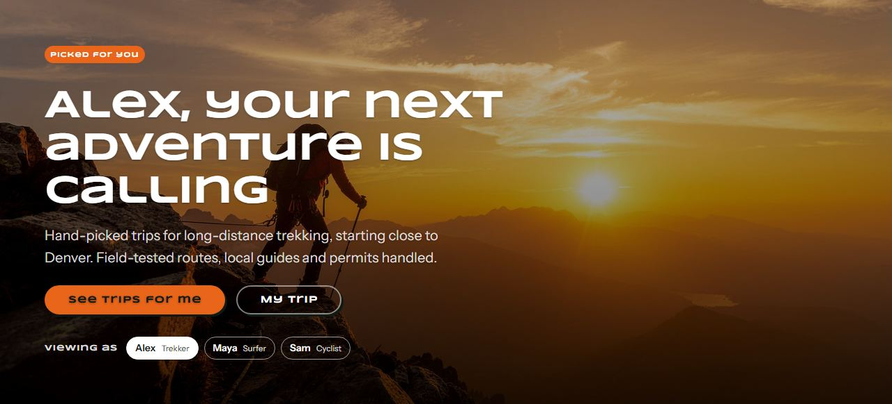 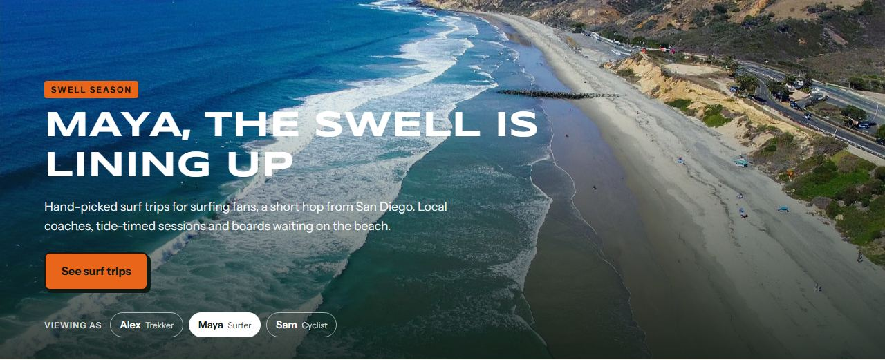 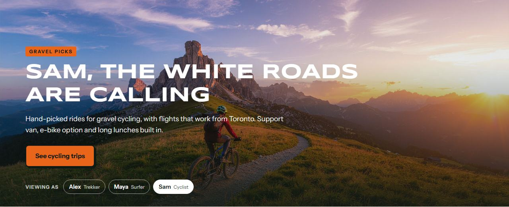

- The **hero** is a single *WKND Next Hero* fragment. Its copy carries the tokens `{{profile.name}}`, `{{profile.interest}}` and `{{profile.location}}`.
- **Personas** are *WKND Next Persona* fragments (name, interest, location and more). The active persona fills in the tokens server-side (`src/lib/personalize.ts`).
- **Audience variations:** the hero has one CF variation per persona. A variation named **"Maya Surfer"** (node `maya_surfer`) matches the persona `maya-surfer`. It carries its own image, eyebrow, headline and button label. Personas without a variation get **master**.
- **Persona switcher:** the "Viewing as" chips are links to `?persona=<slug>`. Each chip is bound to its Persona fragment in UE.
- **Inside Universal Editor** the raw tokens are shown, and edits land on the variation currently shown.

In the CF editor, the hero fragment shows **Main** plus the **Maya Surfer** and **Sam Cyclist** variations. The tokens are typed straight into the fields:

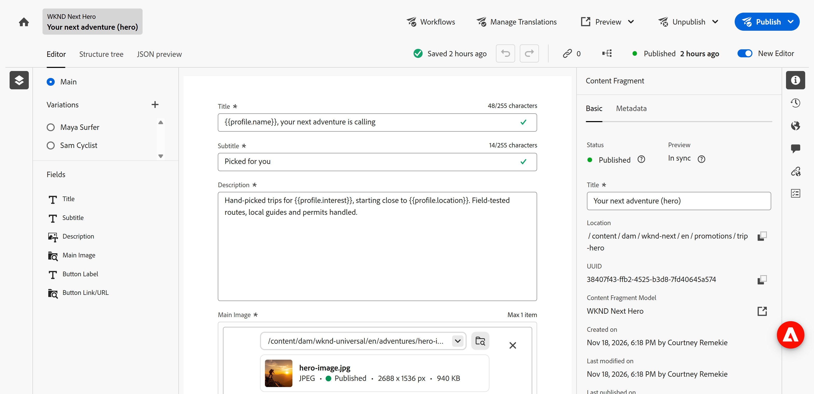

### My Trip dashboard

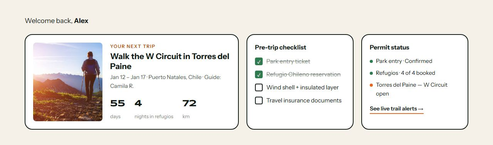

The member's booked trip, the equivalent of the Citizens accounts panel.
- **From AEM:** the trip name and image come from the first adventure (Patagonia). The orange permit line is the **Trail Alert fragment that adventure references**.
- **Hardcoded in the app:** dates, countdown and checklist.

### Adventures: featured layout, booking links, linked alerts

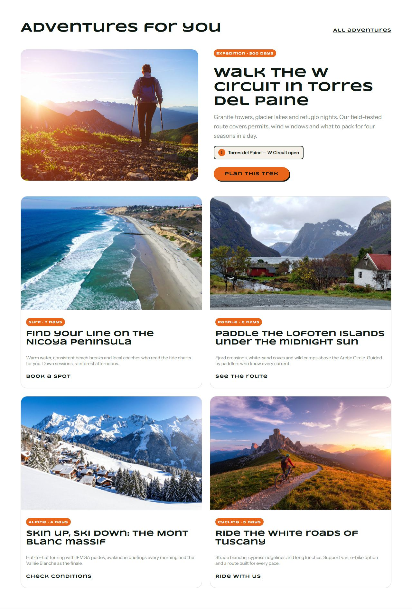

Five *WKND Next Adventure* fragments. Authors control each card from three fields:

| Field | Effect in the app |
|---|---|
| **Card layout** (Featured / Standard) | Featured renders as the site's large featured-story block (image beside the copy). Standard renders as an article card. |
| **Booking page URL** | Where the call-to-action button goes (the matching wknd-adventures.com story). |
| **Trail alert** (fragment reference) | Shows the referenced alert inside the card, editable in place. |

The same fields in the CF editor (*WKND Next Adventure* model):

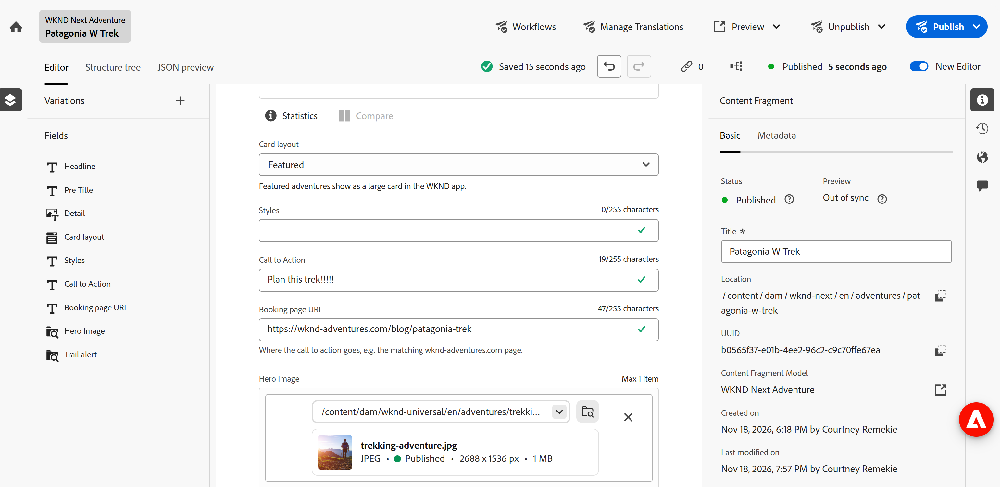

### Trail & permit alerts, live

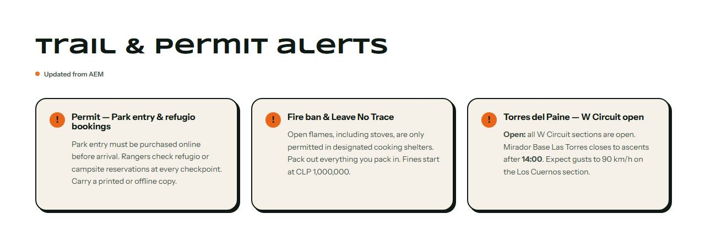

*WKND Next Trail Alert* fragments. `LiveRefresh` re-renders the page every 10 s outside UE, so a published edit shows up without a reload.

### Field Notes

Three *WKND Next Field Note* fragments (headline, rich text body, image).

### CF editor deep link

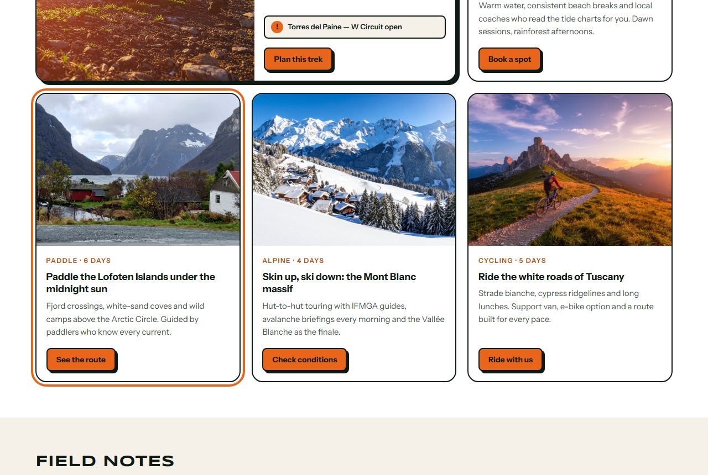

Every WKND Next model has this **Preview URL pattern**:

```
https://wknd-next.vercel.app/?cf=${contentFragment.path}&variation=${contentFragment.variation}
```

`src/app/page.tsx` reads `?cf` and `?variation`:
- A **persona** link switches the app to that persona.
- A **hero** link switches to that variation and to the persona it matches.
- Any other link scrolls to the fragment and outlines it in amber (`src/components/FocusFragment.tsx`). It finds the element through the same `data-aue-resource` attribute Universal Editor uses.

### Visual Content Fragment templates

Each model has one HTML template styled like wknd-adventures.com: pill tags and buttons, Syncopate headings, the site's card radii and hero overlay. The fonts load from `wknd-adventures.com/fonts`, which allows cross-origin requests. The sources are in `docs/aem-setup/templates/`.
- Each template renders an **"Open in WKND app"** link built from `{{properties.path}}`.
- The adventure template switches between the featured-story layout and the article card based on **Card layout**, and shows the booking link and the **referenced trail alert** (via `referencedFragments`).

Pick a template from **HTML Template** in the fragment's preview. Once the fragment is published, its **Preview URL** and **Publish URL** are the standalone HTML renders any channel can embed:

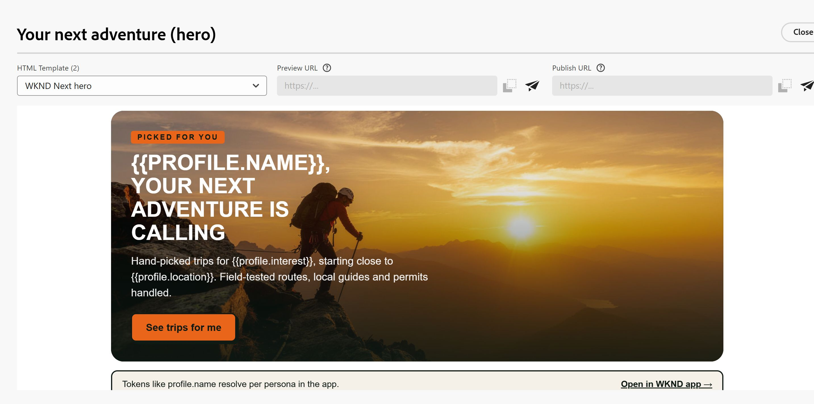

### Mobile

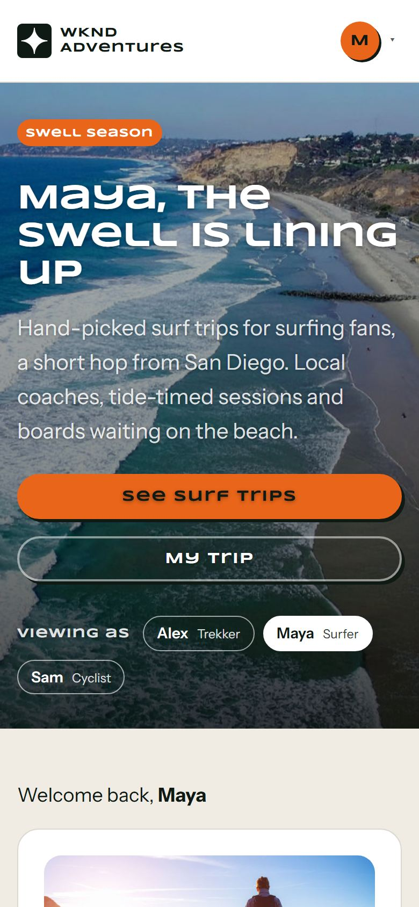

The layout is responsive: the nav collapses and the cards stack.

---

## How it works

```
 Browser / Universal Editor iframe
          │
          ▼
 Next.js 15 App Router on Vercel  ── server components, force-dynamic, no client data fetching
          │  src/lib/cf-delivery.ts
          ▼
 AEM publish:  GET /adobe/sites/cf/fragments?path=<AEM_DAM_ROOT>/<folder>
               GET /adobe/sites/cf/fragments/<id>/variations      (hero variations)
               /content/dam/.../jcr:content/renditions/cq5dam.web.1280.1280.jpeg   (images)

 Universal Editor  ── writes go to the AEM author via its own connection
```

- **One read path.** Every section uses the **CF Delivery API** on publish, read by folder. There are no persisted GraphQL queries to create or publish. `?ts=<now>` busts the CDN cache, so a publish shows on the next render.
- **Server-rendered.** `page.tsx` fetches all five folders in parallel with `Promise.all`. Each fetch is wrapped in `safe()`, so one failing folder empties its section instead of breaking the page.
- **Universal Editor wiring** (`src/app/layout.tsx`):
  - `<meta name="urn:adobe:aue:system:aemconnection" content="aem:<AEM_AUTHOR>">` plus the UE `cors.js`.
  - Every CF-driven element carries `data-aue-resource="urn:aemconnection:<cf path>/jcr:content/data/<variation>"`, plus `data-aue-prop` / `data-aue-type` per field.
  - Outside UE the attributes are inert.
- **Images** use the AEM `cq5dam.web.1280` rendition, because the DAM originals are 1–2 MB.
- **Configuration** is read only in `src/lib/aem-config.ts`. All values are optional and default to the XSC Showcase.
- **Brand:** the app links the **wknd-adventures.com stylesheet itself**: `public/styles/wknd-shared.css`, copied verbatim from the `AEMXSC/wknd-adventures` EDS repo (`styles/wknd-shared.css`), with its Instrument Sans and Syncopate fonts in `public/fonts`. Components use the site's own markup and classes (`navbar`, `logo`, `hero-section`, `tag`, `accent-button`, `button--ghost`, `featured-article`, `article-card`, `inverse-footer`). `src/app/globals.css` only adds the app-specific pieces, built on the site's tokens.

---

## Content model

Showcase: models are in `/conf/wknd-universal`, content in `/content/dam/wknd-next/en/`. Field definitions are in [`docs/aem-setup/models.json`](docs/aem-setup/models.json) and seed content in [`docs/aem-setup/fragments.json`](docs/aem-setup/fragments.json).

| Folder | Model | Fields the app reads | HTML template |
|---|---|---|---|
| `promotions/` | WKND Next Hero | title, subtitle, description, bannerimage, ctalabel (+ variations) | WKND Next hero |
| `personas/` | WKND Next Persona | name, interest, location | WKND Next persona |
| `adventures/` | WKND Next Adventure | headline, pretitle, detail, heroImage, callToAction, **layout**, **ctaUrl**, **termsConditions** → Trail Alert | WKND Next adventure card |
| `field-notes/` | WKND Next Field Note | headline, main, heroImage | WKND Next field note |
| `alerts/` | WKND Next Trail Alert | termsReference, termDetails | WKND Next trail alert |

**Keep the field names exactly as listed.** The app reads them by name.

---

## Run it locally

Requires Node 20+.

```bash
git clone https://github.com/AEMXSC/wknd-next.git
cd wknd-next
npm install
npm run dev            # http://localhost:3000, reads the XSC Showcase by default
```

Other scripts: `npm run build`, `npm start`, and `npm run typecheck`.

To point it at your sandbox, copy `.env.example` to `.env.local`:

| Variable | Default | Purpose |
|---|---|---|
| `AEM_AUTHOR` | XSC Showcase author | UE connection (`urn:adobe:aue:system:aemconnection`) |
| `AEM_PUBLISH` | XSC Showcase publish | All content reads |
| `AEM_DAM_ROOT` | `/content/dam/wknd-next/en` | Folder that holds the five fragment folders |
| `AEM_TOKEN` | unset | Bearer token, only if your publish tier isn't public |
| `NEXT_PUBLIC_FONT_KIT` | unset | Optional Adobe Fonts kit (fonts are already self-hosted) |

Useful URLs:
- `/?persona=maya-surfer` switches persona.
- `/?cf=/content/dam/wknd-next/en/adventures/lofoten-kayak&variation=master` simulates the CF editor link.

---

## Set it up in your own AEM CS sandbox

You need:
- An AEM as a Cloud Service sandbox with author and publish (program and environment IDs).
- Rights to create configurations and models, and to publish.
- A GitHub account and a Vercel account.

### Fast path: let Claude Code do it

With the **AEM MCP server** connected to your sandbox, open this repo in Claude Code and paste:

> Using `docs/aem-setup/models.json`, `fragments.json` and `templates/`, set up wknd-next in my sandbox `https://author-p<PROGRAM>-e<ENV>.adobeaemcloud.com`.
> 1. Create the five models in `/conf/<my-conf>` in `createOrder`. Unlock each copy if needed, set `previewUrlPattern` with my app URL `<YOUR_APP_URL>`, and point the Adventure `termsConditions` field at my Trail Alert model's ID.
> 2. Create `<AEM_DAM_ROOT>` and its five subfolders.
> 3. Create the fragments and the two hero variations.
> 4. Create one template per model from `templates/`, replacing `<YOUR_APP_URL>`.
> 5. Publish the models, then the fragments, to publish and preview. Materialize each fragment's HTML with its template, with hydration on.
> 6. Verify the CF Delivery API on publish returns all five folders.

### Manual path

1. **Configuration folder.** In *Tools → General → Configuration Browser*, create one (e.g. `wknd-next`) with **Content Fragment Models** ticked, or reuse one you own.
2. **Models.** In *Tools → General → Content Fragment Models → your conf*, create the five models from [`models.json`](docs/aem-setup/models.json):
   - Create them in `createOrder`, with the field names exactly as listed.
   - Then, for each model, open **Properties** and set **Preview URL pattern** to `<YOUR_APP_URL>/?cf=${contentFragment.path}&variation=${contentFragment.variation}`.
   - On *WKND Next Adventure*, set the **Trail alert** fragment-reference field to allow only *WKND Next Trail Alert*.
   - **Publish all five models.** Skip this and the publish tier returns no fragments.
3. **Images.** The seed content uses WKND Universal images at `/content/dam/wknd-universal/en/adventures/` (listed in `fragments.json` → `images`). If your sandbox doesn't have them, upload your own and update the paths.
4. **Folders.** Create `AEM_DAM_ROOT` (e.g. `/content/dam/wknd-next/en`) with `promotions`, `personas`, `adventures`, `field-notes` and `alerts`. In the folder's *Properties → Cloud Services*, select your configuration so the models show up in the Create dialog.
5. **Fragments.** Create each fragment from [`fragments.json`](docs/aem-setup/fragments.json) with the given folder, name and model.
   - Set the **Trail alert** on Patagonia to `alerts/torres-del-paine-trail-status`.
   - On `promotions/trip-hero`, add the variations **Maya Surfer** and **Sam Cyclist** with the **+** next to *Variations*. The titles must match the persona slugs. It should look like the [hero variations screenshot](docs/screenshots/cf-editor-hero-variations.png).
   - On each adventure, set **Card layout**, **Booking page URL** and (for Patagonia) **Trail alert**, as in the [adventure fields screenshot](docs/screenshots/cf-editor-adventure.png).
6. **Templates.** On each model, add the matching HTML template from [`docs/aem-setup/templates/`](docs/aem-setup/templates), with `<YOUR_APP_URL>` replaced.
7. **Publish** all fragments (Publish + Preview). Then open a fragment's preview, pick its template under **HTML Template**, and check that the Preview/Publish URLs are filled in (see the [template preview screenshot](docs/screenshots/cf-editor-template-preview.jpg)).
8. **Deploy the app.** Fork or clone the repo, import it at [vercel.com/new](https://vercel.com/new), set `AEM_AUTHOR`, `AEM_PUBLISH` and `AEM_DAM_ROOT`, then deploy. Every push to `main` redeploys.
9. **Universal Editor.** Open `https://experience.adobe.com/#/@<your-org>/aem/editor/canvas/<your-app-host>/`. The app's connection meta points UE at your author. Click any card to edit.

### Verify

```bash
P=https://publish-p<PROGRAM>-e<ENV>.adobeaemcloud.com
for f in promotions personas adventures field-notes alerts; do
  curl -s "$P/adobe/sites/cf/fragments?path=/content/dam/wknd-next/en/$f" | grep -o '"path":"[^"]*"' | wc -l
done   # expect 1, 3, 5, 3, 3
```

---

## Gotchas we hit

- **The preview URL pattern is per model.** It's not per template or per folder. A model shared with other demos means a shared app link, which is why WKND has its own models.
- **Copied models come back locked**, and publishing locks a model again. Unlock it (*Properties*, or `PATCH /locked false`) before editing.
- **Unpublished models mean an empty publish tier.** Fragments on a model that isn't published are silently filtered out of the CF Delivery API on publish.
- **Variation-only images fail in the CF editor's preview** ("Failed to load asset"). The published HTML of the same variation renders fine. Variations that reuse the master's image don't hit this.
- **Referenced fragments in templates need hydration.** Use `{{#each referencedFragments}}…{{fields.x}}…{{/each}}`, because dot notation like `fields.ref.x` doesn't resolve. They appear only in hydrated renders (editor and published HTML).
- **The CF Delivery API is cached at the CDN.** The app appends `?ts=` to every read.
- **Universal Editor edits go to author, but the app reads publish.** Publish after editing to see the change outside UE.

---

## Customizing

- **Rebrand / resync with the site:** replace `public/styles/wknd-shared.css` with the latest from the wknd-adventures repo. For another customer, drop in their site stylesheet and fonts the same way, and map the component classes. Don't restyle by hand.
- **Add a persona:** create a Persona fragment. Optionally add a hero variation whose title normalizes to the persona's slug (e.g. "Jo Climber" → `jo-climber`). No code change is needed.
- **Feature a different adventure:** set its Card layout to Featured. The first adventure in `ADVENTURE_ORDER` (`src/lib/cf-delivery.ts`) is the booked trip in My Trip.
- **New content type:** add a fetcher in `cf-delivery.ts` and a component with `data-aue-*` bindings, then add it to `page.tsx`.

---

## Project structure

```
src/
  app/
    layout.tsx               UE connection meta + cors.js, fonts
    page.tsx                 fetches all CF folders; persona / variation / ?cf= selection
    globals.css              app-only styles (persona switcher, My Trip, alerts) on the site tokens
  components/
    Masthead, UserMenu       header with live badge and member menu
    TripHero                 personalized hero + persona switcher (client: shows raw tokens in UE)
    MyTrip                   booked-trip dashboard; permit line = referenced Trail Alert
    TrailAlerts              alerts band
    AdventuresSection        featured / standard cards, booking links, linked alert
    InsightsGrid             Field Notes
    LiveRefresh              10 s refresh outside UE
    FocusFragment            ?cf= deep link: scroll to and highlight the fragment
  lib/
    aem-config.ts            the only env reader
    cf-delivery.ts           CF Delivery API reads, variations, image renditions, UE resource URNs
    personalize.ts           {{profile.*}} token resolution
    aem-client.ts            shared content types + image helper
  styles/tokens.css          app aliases over the site tokens
public/
  styles/wknd-shared.css     wknd-adventures.com stylesheet, verbatim
  fonts/                     Instrument Sans, Syncopate
docs/
  aem-setup/                 models.json, fragments.json, templates/*.html
  screenshots/
```
